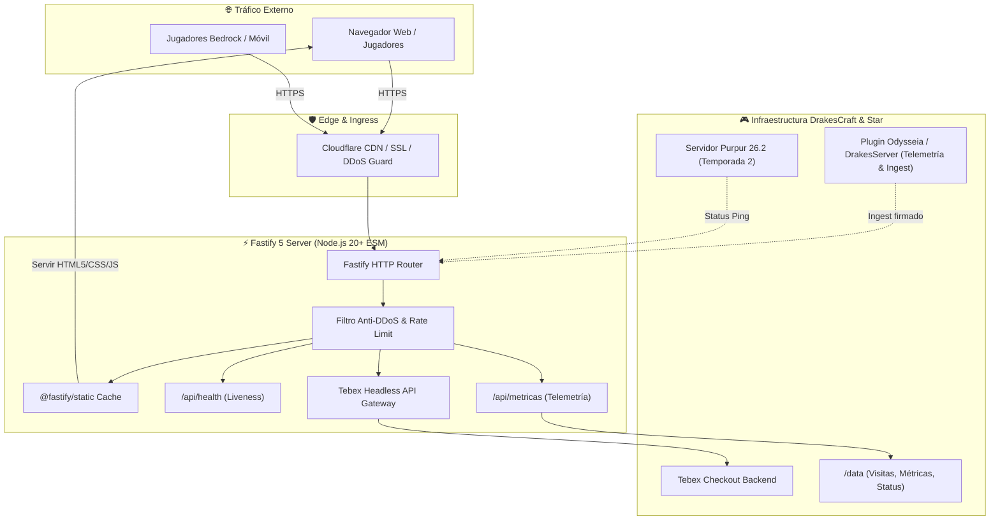
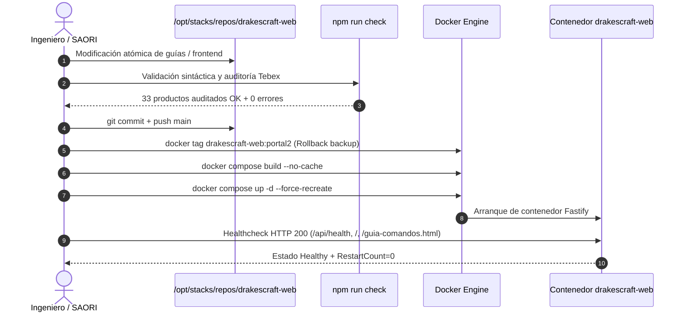

<!-- credits:start -->
> **Credits & license.** Port and maintenance by [JackStar6677-1](https://github.com/JackStar6677-1) and [DrakesCraft Labs](https://github.com/SlimefunNewHorizons). Original authors: [JackStar6677](https://github.com/JackStar6677). Upstream license: **GNU General Public License v3.0** (see [LICENSE](LICENSE)). Details: [docs/UPSTREAM_ATTRIBUTION.md](docs/UPSTREAM_ATTRIBUTION.md) · Policy: [Rights & Attribution](https://github.com/SlimefunNewHorizons/.github/blob/main/RIGHTS_AND_ATTRIBUTION.md). Independent community project, not affiliated with or endorsed by the original authors or the official Slimefun team.
>
> **Créditos y licencia.** Port y mantenimiento por [JackStar6677-1](https://github.com/JackStar6677-1) y [DrakesCraft Labs](https://github.com/SlimefunNewHorizons). Autores originales: [JackStar6677](https://github.com/JackStar6677). Licencia original: **GNU General Public License v3.0**. Detalle en [docs/UPSTREAM_ATTRIBUTION.md](docs/UPSTREAM_ATTRIBUTION.md).
<!-- credits:end -->

  

# DrakesCraft Web Portal & Shop Interface

> ### 🏰 Comunidad Oficial de DrakesCraft
>
> * 🎮 **IP del Servidor**: `mc.drakescraft.cl` *(Java & Bedrock)*
> * 💬 **Discord Oficial**: [discord.gg/rv3vtXZTk7](https://discord.gg/rv3vtXZTk7)
> * 🌐 **Portal Web & Guía**: [web.drakescraft.cl](https://web.drakescraft.cl)
> * 🛒 **Tienda Oficial**: [drakescraft-v2.tebex.io](https://drakescraft-v2.tebex.io)

---

Portal web oficial, catálogo interactivo de la tienda Tebex y centro de guías completas para la comunidad de **DrakesCraft**. Mantenido por **DrakesCraft Labs**.

---

## 🎯 Objetivo

Ofrecer a la comunidad de jugadores una interfaz web de alto rendimiento, elegante y responsive para consultar el estado en vivo del servidor, manuales interactivos de comandos y Slimefun, escalafón de rangos y límites, métricas del ecosistema y catálogo de compras integrado de forma segura con la API de Tebex.

---

## 🏛️ Arquitectura del Sistema

---

## ⚡ Estructura del Sitio

- **Portal Principal (`index.html`)**:
  - Estado del servidor en tiempo real vía socket Ping, dirección IP (`mc.drakescraft.cl`) y accesos comunitarios.
- **Centro de Guías Interactivas**:
  - `guia-comandos.html`: Manual interactivo de comandos organizados por modalidad con filtros en tiempo real, soporte Bedrock (`/offhand`) y alias.
  - `guia-rangos.html`: Comparativa de límites efectivos (hogares, protecciones, bóvedas, warps), kits y multiplicadores por rango.
  - `guia-slimefun.html`: Documentación viva de máquinas, reactores, circuitos y los más de 28 addons de Slimefun activos.
  - `guia.html`: Visión general de las 5 modalidades (Survival, Clásico, SkyBlock, OneBlock, Laboratorio).
- **Tienda Oficial & Catálogo (`catalog/store-catalog.js`)**:
  - Catálogo auditado con verificación estricta de 33 productos Tebex, precios en CLP/USD y pasarela protegida.
- **Métricas & Telemetría (`metricas.html`)**:
  - Datos de actividad, picos de jugadores y salud del ecosistema calculados periódicamente.

---

## 🛠️ Tecnologías y Despliegue

- **Frontend**: Vanilla HTML5, CSS3 moderno con variables HSL y arquitectura modular, JavaScript ES6+ nativo sin bundles pesados.
- **Backend**: Fastify 5 en Node.js 20+ ESM con `@fastify/static`.
- **Contenedorización**: Docker Compose sobre `/opt/stacks/drakescraft-web` con healthcheck automatizado.
- **Integraciones**: Tebex Headless API, Minecraft Server Ping protocol y telemetría Odysseia.

---

## Estado editorial de T2 (5 de noviembre de 2026)

La T2 con Purpur 26.2 está en pruebas en Dallas, con whitelist solo para staff. La web informa del mantenimiento en español e inglés; la compatibilidad de clientes Java 1.21 a 26.x y Bedrock sigue en validación. La T1 (1.21.11) está archivada y sus enlaces de descarga aún no están disponibles.

Los eventos de noviembre están cancelados: `/api/eventos` conserva HTTP 200 y devuelve `status: cancelled`, `todayEvent: null` y `events: []`. El catálogo histórico permanece intacto. `NOVEMBER_EVENTS_ENABLED=true` permite consultar de nuevo ese catálogo; restaurar toda la presentación requiere revertir el commit editorial. El homenaje anual a Kika del 4 de noviembre es independiente del calendario del juego.

Validación: `npm run check` y `npm test` contra una instancia aislada sin credenciales; las pruebas incluyen el calendario cancelado y la regresión de tienda. El despliegue reconstruye únicamente `drakescraft-web`, conservando la imagen anterior para rollback. No requiere reiniciar Minecraft.

## 📄 License

Maintained by [**JackStar6677-1**](https://github.com/JackStar6677-1) under [**DrakesCraft Labs**](https://github.com/SlimefunNewHorizons).

Distributed under the **GNU General Public License v3.0 (GPLv3)**. See the [`LICENSE`](LICENSE) file for complete terms.
